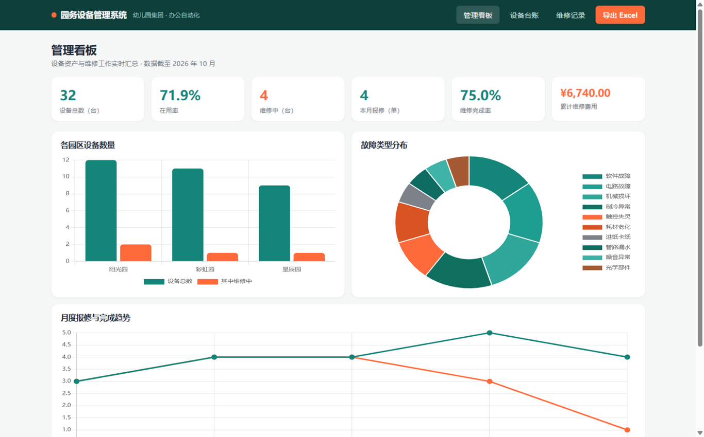
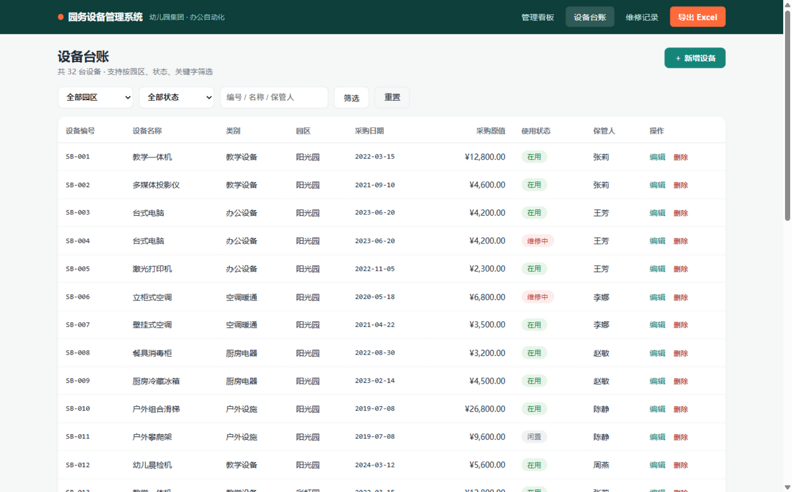
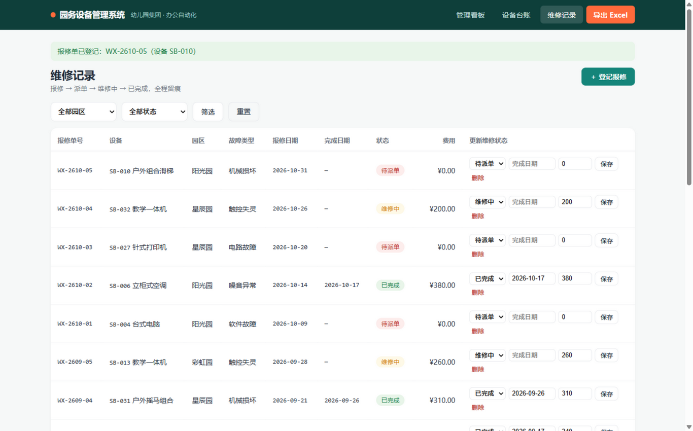
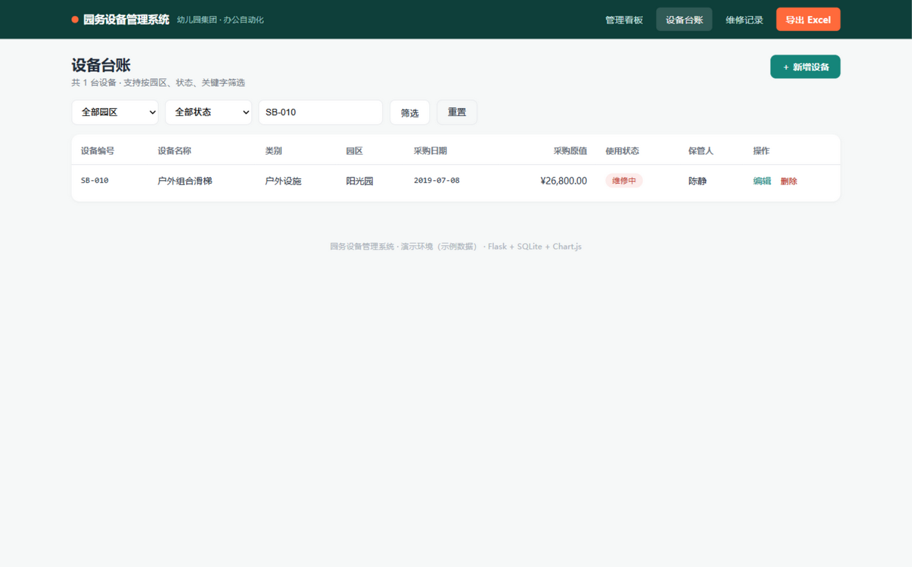

# 园务设备管理系统（幼儿园集团办公自动化与数据报表系统）

> 一个真实可运行的幼儿园集团设备管理与数据报表系统：设备台账、维修记录、统计看板、Excel 报表导出。
> Python (Flask) + SQLite + Chart.js + openpyxl，中文界面，面向教育机构行政管理场景。


**声明**：本项目为个人技术演示作品，使用**虚构的示例数据**，不代表任何真实幼儿园的实际使用情况。

---

## 一、系统功能

| 模块 | 功能 | 说明 |
|------|------|------|
| 管理看板 | KPI 指标 + 3 类图表 | 设备总数、在用率、本月报修、完成率、费用合计；柱状图 / 环形图 / 折线图实时联动 |
| 设备台账 | 增删改查 + 多维筛选 | 按园区 / 使用状态 / 关键字筛选；编号唯一性校验；有维修记录的设备禁止删除 |
| 维修记录 | 报修登记 + 状态流转 | 单号按月自动编号（WX-YYMM-XX）；状态流转 待派单→维修中→已完成，与设备状态双向联动 |
| Excel 导出 | 一键生成报表 | 实时从数据库生成 4 表工作簿（台账 / 维修 / 公式化月度统计 / KPI 看板），含数据验证与条件格式 |

## 二、操作截图

| 管理看板 | 设备台账 |
|---|---|
|  |  |

| 登记报修（提交后自动编号） | 设备状态联动（SB-010 → 维修中） |
|---|---|
|  |  |

> 更多截图见 [screenshots/](screenshots/) 目录：`04-新增设备表单.png`、`05-登记报修表单.png`、`07-看板数据联动.png`。

## 三、快速开始

### 环境要求
- Python 3.10+（开发环境为 3.13）

### 安装与运行

```bash
# 1. 进入项目目录
cd kindergarten-equipment-system

# 2. （可选）创建虚拟环境
python -m venv .venv
.venv\Scripts\activate        # Windows
source .venv/bin/activate     # macOS / Linux

# 3. 安装依赖
pip install -r requirements.txt

# 4. 启动（首次运行自动建库并写入示例数据）
python run.py
# => 园务设备管理系统已启动：http://127.0.0.1:5177
```

浏览器访问 **http://127.0.0.1:5177** 即可。默认端口 5177，可通过 `python run.py serve 8080` 指定。

### 运行测试

```bash
pip install pytest
python -m pytest tests/ -v
# => 20 passed（详见 docs/测试报告.md）
```

### 初始化数据库（可选）

数据库为 `instance/kindergarten.db`，删除后重启即自动重建并写入示例数据（32 台设备、20 条维修记录）。

## 四、项目结构

```
kindergarten-equipment-system/
├── run.py                     # 启动入口
├── requirements.txt
├── app/
│   ├── __init__.py            # 应用工厂（自动建库）
│   ├── db.py                  # 数据层：连接 / 建表 / 示例数据 / 单号规则
│   ├── routes.py              # 路由：看板 / 台账 / 维修 / 统计 API / 导出
│   ├── excel_export.py        # openpyxl 报表引擎
│   ├── templates/             # Jinja2 模板（6 个页面）
│   └── static/                # 样式与本地化 Chart.js
├── tests/                     # pytest 测试（20 个用例）
├── docs/                      # 设计文档 / 测试报告 / 面试问答等
├── deliverables/              # 本系统导出的办公交付物（Excel/Word/PPT/规范）
├── scripts/                   # 办公文件生成脚本（可独立复现交付物）
└── screenshots/               # 实际运行截图
```

## 五、办公交付物（deliverables/）

以下文件均由本项目的真实数据生成，可通过 `scripts/` 中的脚本复现：

| 文件 | 内容 |
|------|------|
| `园务设备管理系统.xlsx` | 设备台账 / 维修记录 / 月度统计（COUNTIFS·SUMIFS 公式）/ 管理看板 / 数据透视，204 个公式经 LibreOffice 重算零错误 |
| `月度信息工作报告_2026年10月.docx` | 月度工作报告（含数据表格与分析） |
| `信息设备使用与维护培训.pptx` | 12 页员工培训课件（含原生图表） |
| `Excel数据录入规范.docx` | 数据录入制度文档 |

## 六、设计要点（详见 [docs/设计文档.md](docs/设计文档.md)）

- **状态机联动**：报修登记自动把设备置为「维修中」，维修完成自动恢复「在用」，杜绝台账与实际脱节
- **报表即代码**：Excel 导出不是简单列表，而是重建「公式化月度统计」——打开导出文件即可看到 COUNTIFS/SUMIFS 实时公式
- **录入约束前置**：编号唯一、日期格式、枚举词表在服务端统一校验，与《Excel 数据录入规范》制度一致

## 七、文档索引

- [设计文档](docs/设计文档.md) — 架构、数据模型、页面与接口设计
- [测试报告](docs/测试报告.md) — 20 个用例及真实运行结果
- [项目成果与技术难点](docs/项目成果与技术难点.md)
- [面试问题及回答准备](docs/面试问答准备.md)

## 八、License

MIT
